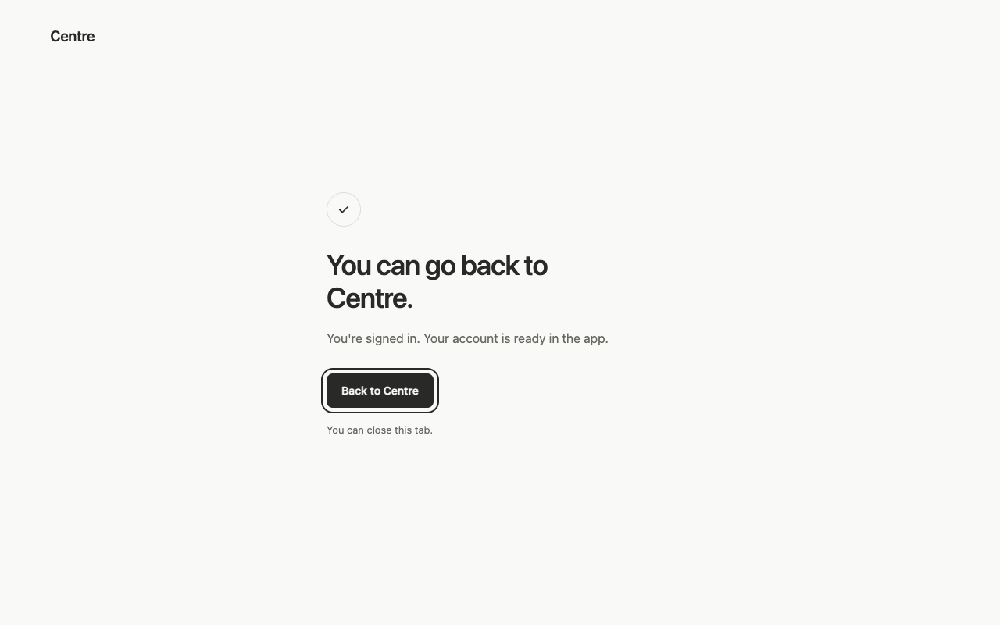
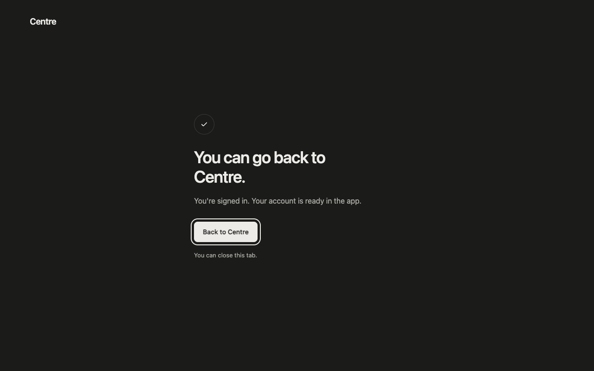
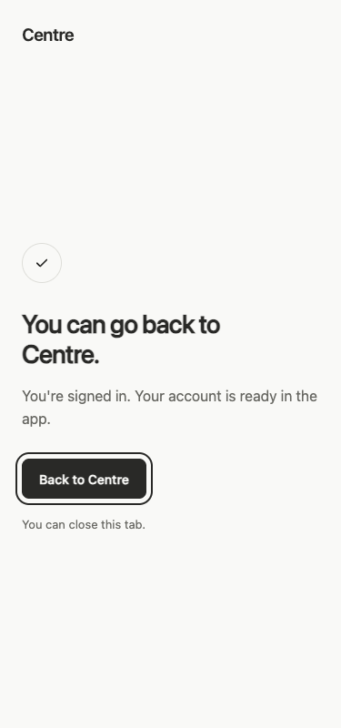
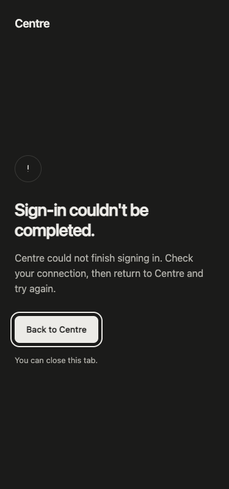

# Google login callback fix

The installed 0.1.15 app reached Google successfully, then its Node request to Centre Cloud failed with `SELF_SIGNED_CERT_IN_CHAIN`. The embedded Node runtime used its bundled certificate authorities without the Mac's trusted roots. The [actual transport probe](transport-reproduction.json) reproduces that failure and reaches the same endpoint after including the operating system's trusted certificates. HTTP 401 is expected for this anonymous probe.

The Electron startup now appends system-trusted certificates to its existing defaults before the service starts. It preserves bundled and configured extra roots. Certificate verification remains enabled; a real local self-signed HTTPS peer is still rejected by the regression test. This follows [Node's certificate-store API](https://nodejs.org/api/tls.html#tlssetdefaultcacertificatescerts).

The browser callback renders a Centre confirmation page with **You can go back to Centre.** and an explicit `centre://action/app.settings` link. Failed or cancelled sign-ins receive the same layout with honest retry guidance. Response headers prohibit caching, framing and referrers; nonce-scoped script/style policies restrict the page. The page removes OAuth parameters from browser history and never includes provider tokens or authorization codes.

## Verification

- Full local suite: 400 passed, 0 failed. Typecheck and production renderer/Electron builds pass.
- Native login verifier: 8 checks pass with the production main process, actual loopback listener, real IPC/service/disk, simulated Google token/profile replies and real HTTPS to Centre Cloud. It verifies successful account persistence, the return action, rejection of an invalid cloud identity and no renderer errors. See [native-verification.json](native-verification.json). Run `node scripts/verify-google-login.mjs` after building.
- Existing native flows: 46 passed, 0 renderer errors. Small/Default/Large text sizing and reload persistence pass.
- Real browser screenshots: success in light/dark at 1280px and light at 375px; failure in dark at 375px. Keyboard focus, 44px return action, stripped callback query, no overflow and no external resource requests pass. See [visual-verification.json](visual-verification.json).
- T3's snapshot step timed out twice. The existing isolated Playwright/Chrome workflow supplied the captures. All outcomes in these screenshots are synthetic fixtures of the production renderer, not live Google consent.

| State | Capture |
| --- | --- |
| Success, light |  |
| Success, dark |  |
| Success, narrow |  |
| Failure, narrow |  |

## Platform scope and remaining limits

An isolated `gpt-6-luna` max parity review confirmed that iOS uses Google Sign-In and Foundation URLSession directly. It has no desktop loopback callback or desktop OAuth secret exchange and already uses operating-system trust. Parent source inspection confirmed this in `ios/CentreApp/AppModel.swift` and `ios/Sources/CentreCore/CloudHTTP.swift`. No iOS change applies and no new simulator result is claimed.

Fresh real Google browser consent was not automated. The exact failing network hop is reproduced and fixed against the real deployed service; provider success is exercised with explicitly simulated Google replies. Apple signing/distribution and the held attempt-comparison feature are unchanged.
