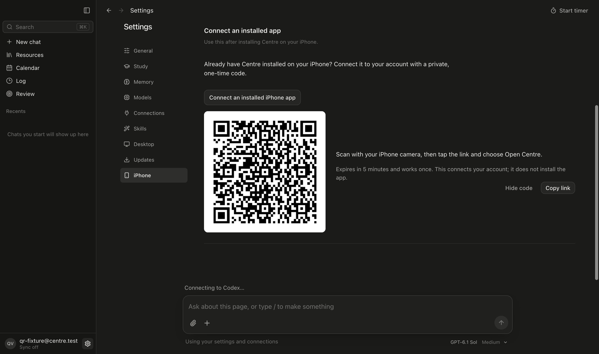
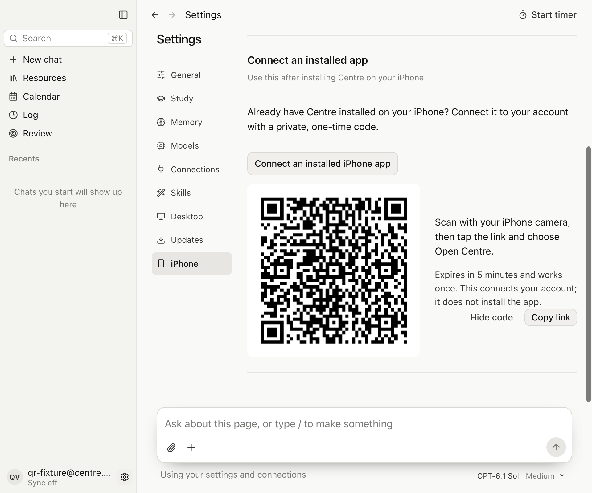
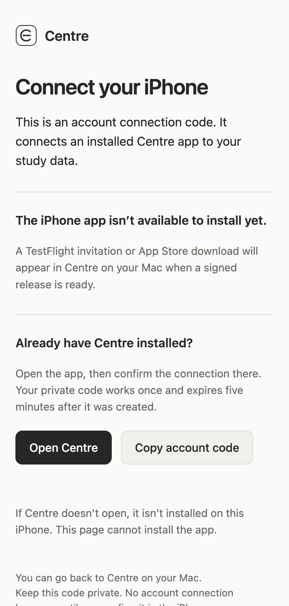
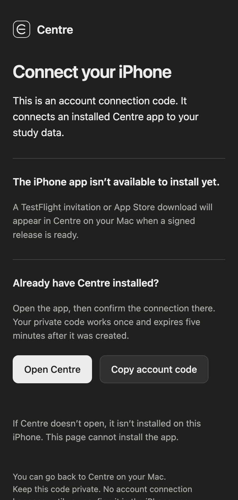

# iPhone QR handoff verification

The previous account QR contained `centre://pair?...`, which requires a registered app handler. Both that image and the new image decode with Apple's Core Image QR detector; a physical iPhone's reported “no data found” screen was not reproduced on this host. The replacement QR contains an HTTPS URL that opens a public Centre web page before offering an explicit **Open Centre** action.

The one-time secret is in the URL fragment, not the HTTP request. The page removes it from the address bar, makes no background account requests, and does not redeem it. Same-tab rescans replace the old invitation. The existing five-minute expiry and one-use redemption remain unchanged. The desktop copy action uses an authorized, text-only Electron IPC call while general renderer permissions remain denied.

The iOS parser accepts both formats. Its new **Paste pairing link** control fills the cloud address and code without connecting until the student confirms. No Apple universal-link association is claimed.

## Checks

- `npm test`: 404 tests passed, none failed or skipped.
- `npm run typecheck`, production web/Electron builds and Worker dry run passed.
- `node --import tsx scripts/verify-mobile-pairing.mjs`: 18 actual Electron renderer/preload/service and phone-width web-page checks passed; no uncaught renderer errors. Only cloud account status and invitation replies are synthetic. Tests cover signed-out blocking, QR/copy, hide/expiry, failed creation, same-tab rescans, explicit app handoff, no background requests, and 960px large text / 375px web layouts.
- `swift scripts/verify-qr.swift .runtime/mobile-pairing-proof rendered-qr screen-qr`: both the generated PNG and the QR captured from the actual rendered window decode to the expected HTTPS URL. Expected values use a nonfunctional fixture code.
- `TMPDIR="$PWD/.runtime/swift-tmp" swift run --disable-sandbox --scratch-path .runtime/swift-build --package-path ios CentreCoreVerify`: filesystem/timer checks and HTTPS/legacy pairing acceptance/rejection checks passed. Network transport in this executable is simulated.
- `swiftc -frontend -parse ios/CentreApp/Views.swift` and `git diff --check` passed.

## Captures

All account data and codes below are disposable fixtures. The phone-width captures are the real web handoff in Chromium/Electron, not native iOS screenshots.

[Raw verification results](verification.json)

## Remaining limits

There is no signed iPhone release, TestFlight invitation or App Store listing. The installation QR remains absent until a real Apple link is configured. The new account QR cannot install an app. This host has Command Line Tools but no Xcode, XCTest module, simulator or attached iPhone, so native iOS compilation, the new paste control, Safari and a physical Camera scan remain unverified. Existing native evidence for earlier source does not verify these changes. No signing, upload or billing change was performed.

Code authors: `gpt-6.1-sol` (desktop, Worker, clipboard and verification); `gpt-6-luna` (iOS parser, paste control and XCTest cases).
