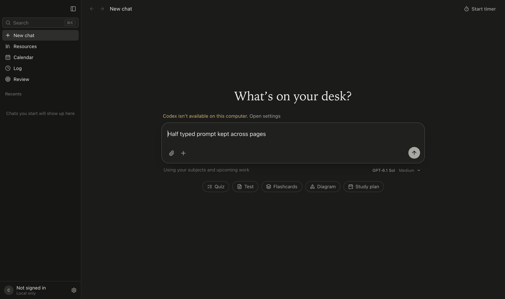
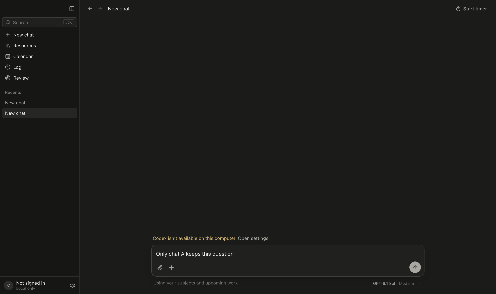
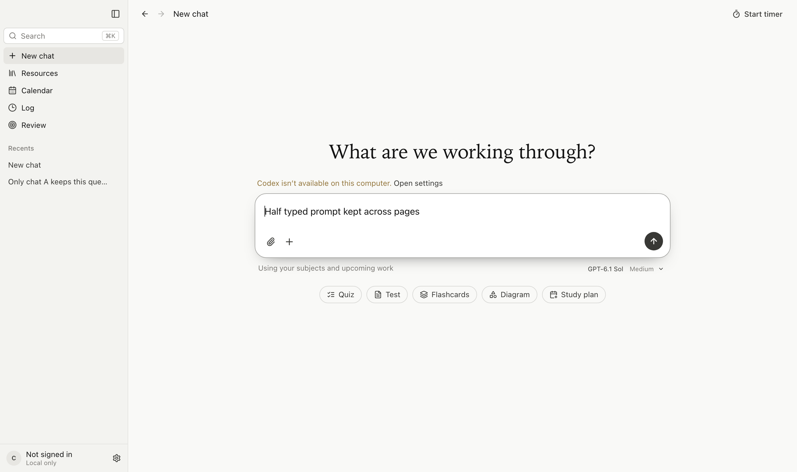
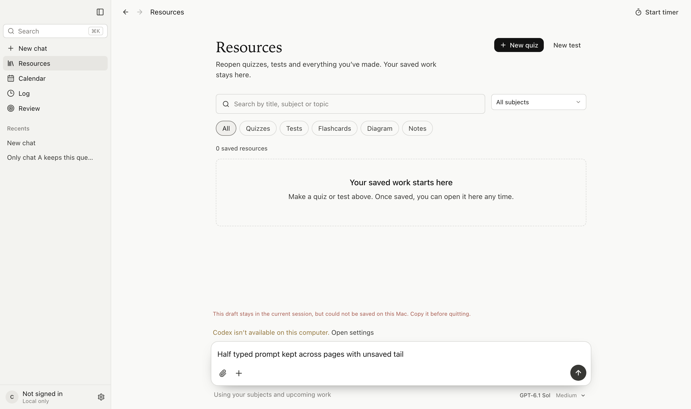
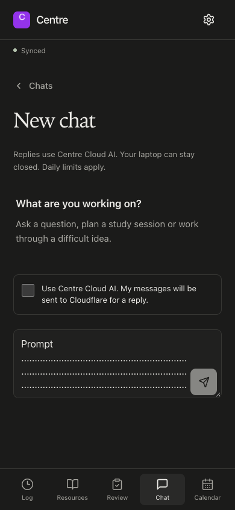

# Unsent prompt retention

Mac text previously lived in the mounted composer, so navigating away discarded it. The phone web app already saved private drafts, but restoring a conversation could overtake queued writes and return older text. Both failures were reproduced before the fixes.

Mac drafts now save synchronously to local Chromium storage, keyed by signed-in account identities and chat ID. Home and the page dock share the new-chat draft; saved chats have their own drafts. Sending clears that composer only. Failed storage writes preserve the current-session text and show a warning. Draft text is not a cloud record. This change covers text; staged attachment behavior is unchanged.

The phone web app retains the current conversation across study tabs. Restoration waits behind prior writes, disables input while opening, and offers a retry if restoration fails. Its IndexedDB drafts remain workspace scoped.

Native iOS stores a backward-compatible, local-only composer map in each workspace replica. SwiftUI updates memory synchronously and serializes/coalesces durable saves. New-chat drafts have a stable identity and an Unsent prompt row. A successful message transaction clears only a matching submitted draft, preserving newer text and other chats. Backgrounding flushes queued saves. Logout removes private local data as before.

## Verification

- `npm test`: 448 tests pass, zero failures, including six Mac draft storage tests.
- `npm run build`: type checking and production Mac renderer/phone web builds pass.
- `node scripts/verify-prompt-drafts.mjs`: 15 actual Electron checks pass, including navigation, reload, separate chats, Send and forced local storage failure/recovery. Temporary profile and local service; no live model.
- `CENTRE_PLAYWRIGHT_MODULE=<playwright-core> node scripts/verify-phone-prompt-drafts.mjs`: six real Chromium/IndexedDB/SQLite Worker fixture checks pass, including 500 input events followed by immediate navigation. Identity is simulated.
- Existing Electron verifier: 46 checks pass with no renderer errors.
- Native Swift parse, direct CentreCore compilation and the real executable at `ios/Verification/main.swift` pass, including 500 persisted updates, reopen, older-file decoding, chat/workspace isolation and conditional send clearing. Parent verification also corrected a test fixture that attempted to read an unwritten workspace file.
- Native XCTest and SwiftUI simulator flows remain unverified. This host has Command Line Tools without full Xcode, and hosted jobs never started.

See [verification.json](verification.json), [Mac report](mac-report.json), [phone report](phone-report.json), [native portable output](native-portable.txt) and [before-fix Mac result](mac-before.json).

## GitHub check failures

Desktop run [39929266301](https://github.com/etphli/centre/actions/runs/39929266301) ran zero steps. Its annotation says account payments failed or the spending limit must be increased. This is runner access failure before any test assertion. [Raw annotation](github-runner-block.json). No billing settings, test checks or workflows were changed to conceal it.

## Actual final captures

Synthetic text and accounts only. The native simulator cannot be captured here, so no native UI screenshot is claimed.

## Model authorship

- `gpt-6.1-sol`: Mac and phone web implementation, integration, parent verification and native verification-fixture correction.
- `gpt-6-luna`: native iOS implementation and native XCTest/UI coverage.
