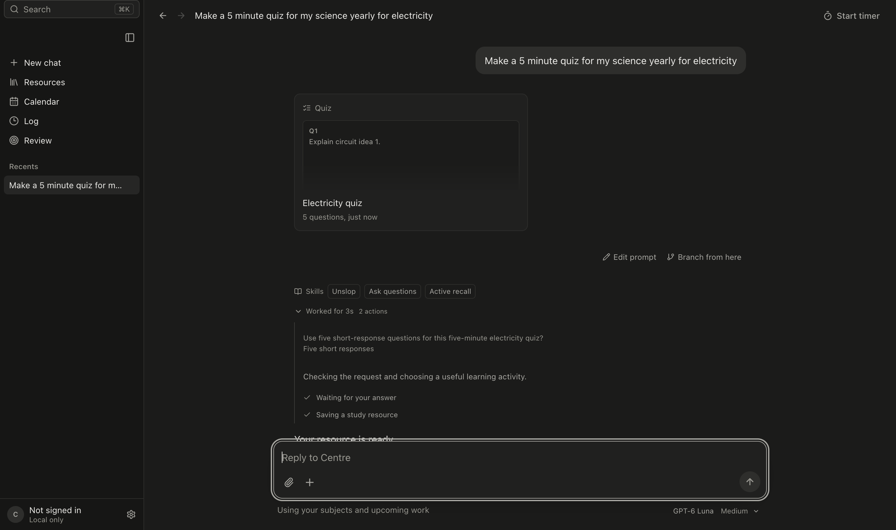
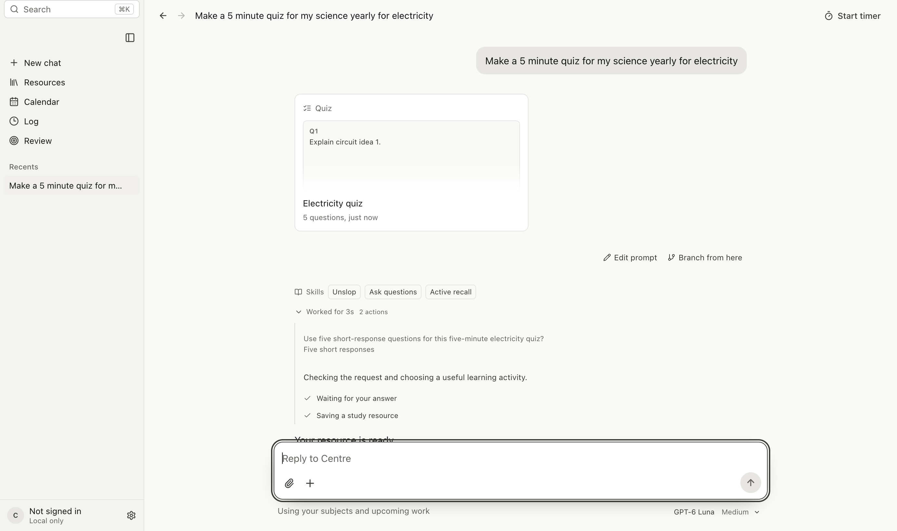

# Clarification answers in reasoning

Popup questions and answers retain their backend history records and appear in reasoning instead of user bubbles. The original prompt appears once while answering, continuing and after reload. Desktop startup tags older completed popup answers only when local turn checkpoints identify them. Ordinary untagged history remains visible.

Desktop evidence uses synthetic study data and a deterministic Codex CLI peer, with the actual production Electron renderer, service and IPC. No real model inference is claimed.

- `npm test`: 477 tests passed.
- `npm run build`: typecheck and desktop/iPhone production builds passed. Existing bundle-size warnings remain.
- `npm run build:electron`: passed using the existing local OAuth configuration.
- `CENTRE_VERIFY_QUESTIONS_ONLY=1 node scripts/verify-interactions.mjs`: passed. Tool and structured questions, live continuation, one user bubble, expandable answers, dark/light themes, narrow width, keyboard collapse and reload checked. See `desktop-checks.json`.
- `npx tsx --test server/question-routing.test.ts`: passed after adding failure/retry coverage. Saved answers survive failed continuation and retry targets the original prompt.
- Combined iOS `QuestionAnswerHistoryTests`: 4 passed. Strict tagging, multiline batches, ordering, pending/offline replica and sync behavior checked.
- iOS native build/UI remain unverified. No simulator devices or runtimes are installed. Native build attempt failed launching a SwiftPM manifest process with Permission denied. The delegated full portable run passed 99/100 with an unrelated study-log future-time assertion failure. A minimal existing PracticeHistoryTests default-argument compile error was repaired to run the suite.
- The broad interaction sweep was not completed. An earlier attempt stopped at a diagram fixture control lookup; the focused clarification run passes.

The local arm64 app was packaged without Developer ID signing, ad-hoc signed, and its bundle signature verified. Packaged renderer and service hashes match the verified build. The installed copy was reopened successfully; message IDs/content and saved study records were preserved. A rollback app and state backup are retained under ignored `.runtime/question-history-install/`.

Code authors: `gpt-6.1-sol` implemented desktop, server, shared and iPhone web changes; `gpt-6-luna` implemented native iOS parity and its tests. No cloud deployment or iOS distribution was performed.
