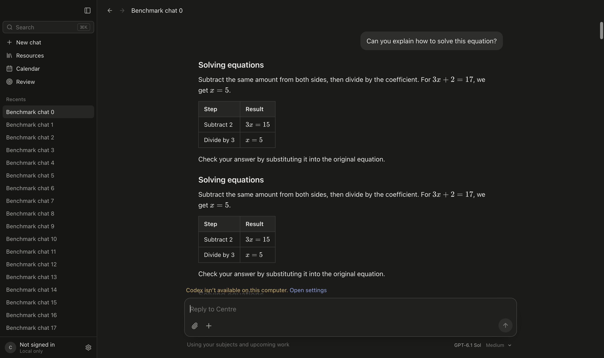

# Centre performance measurements

Measured on 20 October 2026 with production Electron 44.9.1 on an Apple M1 Mac. The baseline is `main` at `489650f`; the optimized build contains this branch's performance changes. Both use the same synthetic fixture of 80 chats and 1,920 messages. AI is disabled and user data is untouched.

The table reports medians from three separate app launches per build. Each idle measurement lasts 11 seconds and includes exactly two polls. The benchmark disables Chromium's background throttling and forces the page to report foreground visibility so both builds do the same work.

| Metric | Before | After |
| --- | ---: | ---: |
| Startup JavaScript | 930 KB | 494 KB |
| Entry to home | 694 ms | 670 ms |
| First chat without prior hover | 129 ms | 133 ms |
| Idle CPU time, all Electron processes | 559 ms | 213 ms |
| Idle renderer work | 196 ms | 15 ms |
| Retained renderer JavaScript heap | 14.52 MB | 9.52 MB |
| Idle IPC response payloads | 2.93 MB | 8 bytes |
| Renderer working set | 146 MiB | 147 MiB |

Idle app CPU time falls about 62%, renderer work falls about 92%, and retained JavaScript memory falls about 34%. Startup JavaScript falls about 47%. Startup and first-chat timings overlap between runs. This sample does not establish a first-chat speed improvement or a reduction in the app's total RAM. The Markdown code remains in the installed app and loads when needed or when a saved chat receives hover or keyboard focus.

The hover and focus checks each observed exactly one Markdown module load before navigation, then rendered the chat's maths. Repeated intent reused the same import. The separate intent checks verify behavior; their single-run timings are not used for the before-and-after comparison.

Raw measurements are in [before.json](before.json), [after.json](after.json), [hover.json](hover.json), and [focus.json](focus.json).

## Reproduce

Build the production renderer and Electron process using the Google OAuth configuration described in the project README. Run these commands from the checkout being measured:

```sh
npm run build
npm run build:electron
npm run benchmark:performance -- current 3
npm run benchmark:performance -- hover 1 --hover --capture
npm run benchmark:performance -- focus 1 --focus
```

To use the same benchmark script against a separate built baseline checkout:

```sh
CENTRE_BENCHMARK_BUILD_ROOT=/absolute/path/to/baseline npm run benchmark:performance -- before 3
```

Reports and optional screenshots go under `.runtime/performance/`. The benchmark creates and removes its own temporary data and Electron profile. Startup runs from the benchmark entry point through the rendered home screen. First-chat timing includes rendering the fixture's Markdown and maths. CPU time is accumulated work, not elapsed time. JavaScript heap is measured after garbage collection. These measurements do not cover AI response latency or battery life.

## Verification

- `npm run check`: passed, including all 55 tests, TypeScript, and the production renderer build.
- `npm run build:electron`: passed.
- Hover and keyboard-focus preload checks: passed in the production Electron app. No early navigation, one module load, and rendered maths after opening the chat.
- `git diff --check` and `node --check scripts/benchmark-performance.mjs`: passed.
- `node scripts/verify-flows.mjs`: stopped at the existing diagram-height assertion. The same failure was reproduced before the performance changes; later steps remain unverified.
- The production web UI was also checked for empty unchanged-state responses, fresh data after writes, skipping hidden polls, refreshing on return, and a settings save while an older poll was paused.

## UI evidence

The production app renders maths after the saved-chat hover preloads its Markdown module. The screenshot uses synthetic study data and disabled AI.



GPT-6.1 Sol implemented the performance changes, benchmark, tests, and documentation.
